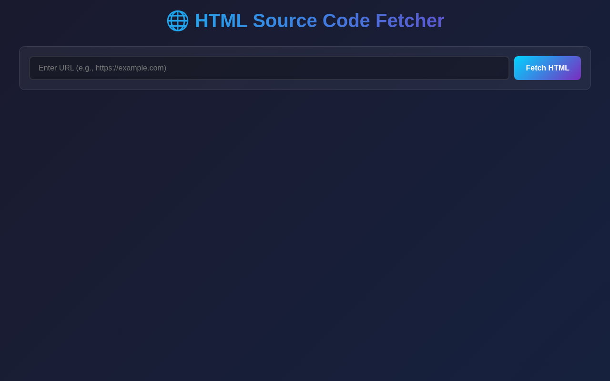
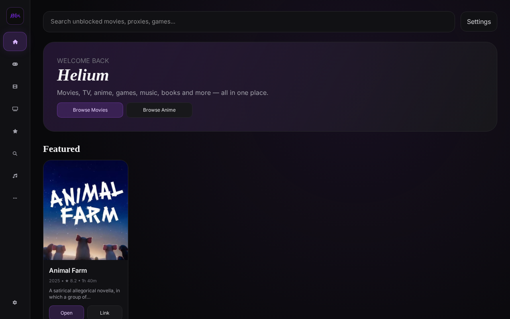
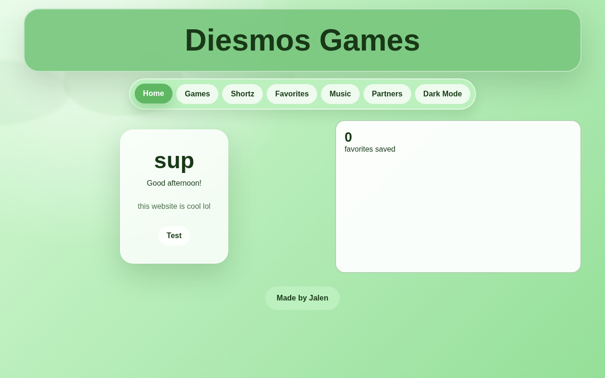
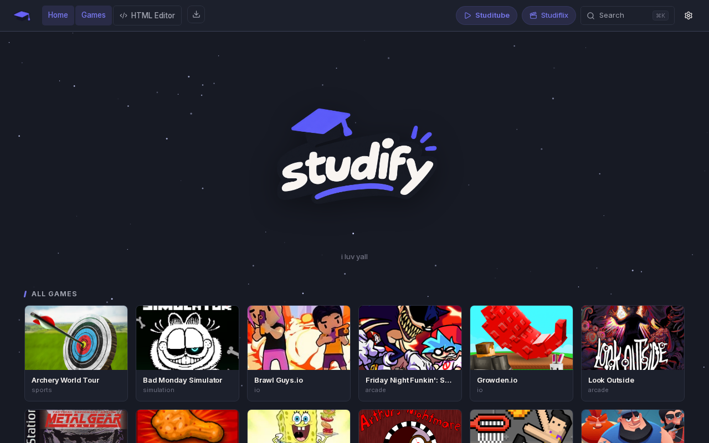
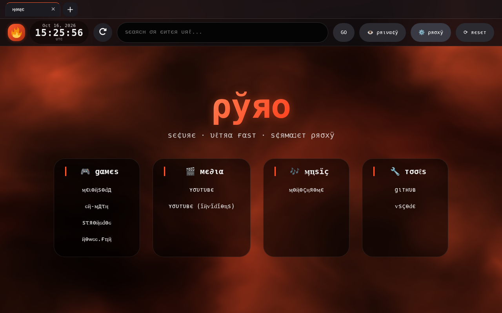

# Your 7 HTML files — checked

**How I checked.** Each file was served over HTTP and opened in a real headless Chromium.
I recorded uncaught errors + the stack trace, console messages, network responses, how much
UI actually rendered, then clicked around and took screenshots. Screenshots are in this folder;
the script that does it is `tests/check_uploads.py` (re-run any time).

## Verdict at a glance

| # | File | Size | Runs? | Blocker |
|---|------|------|-------|---------|
| 1 | `urltohtml.html` | 6 KB | ✅ **works** | none — but it can only fetch sites that allow CORS (browser rule) |
| 2 | `codeeditor-1.html` | 8 KB | ✅ **works** | needs internet: CodeMirror + JSZip load from cdnjs |
| 3 | `quantumbrouser.html` | 11 KB | ✅ **works** | its iframe browser is blocked by X-Frame-Options on most big sites (browser rule) |
| 4 | `swhelium-1.html` | 1.2 MB | ✅ **works** (all 15 images fine) | it's a static snapshot — buttons link out, no proxy inside |
| 5 | `diesmos.html` | 88 KB | ⚠️ renders, **2 errors** | `initGlassMode is not defined`; remote `main.js` throws so the games grid stays empty |
| 6 | `studify_v1.html` | 12 MB | ⚠️ shell works, **games can't launch** | incomplete upload — needs `games/`, `assets/thumbs/`, `sw.js` |
| 7 | `pyroproxy.html` | 28 KB | ❌ **proxy is dead as uploaded** | needs a `/sail/` folder of libraries that wasn't included |

---

## 1. `urltohtml.html` — ✅ works

Clean render, zero errors, zero failed requests. I exercised it:

| Input | Result |
|---|---|
| `https://example.com` | `Error: Failed to fetch (CORS may be blocked)` — **correct behaviour**, example.com sends no CORS headers, a page can never bypass that |
| `https://api.github.com` | `✓ HTML fetched successfully!` — output pane opened, line count shown |

The error message it prints is honest, so nothing to fix. Its real limits: `fetch()` is
subject to CORS, so it can only read sites that opt in. **To make it read *any* site, it should
fetch through a proxy** — inside NebulaOS it can use `Nebula.Proxy` and get real power.



## 2. `codeeditor-1.html` — ✅ works

456 DOM nodes, 12 CodeMirror files pulled from cdnjs (all 200), zero errors.
Caveat: it is **not** offline-capable — with no internet the editor loses syntax highlighting,
themes and the ZIP export. Fine if hosted; if you want it fully offline I can inline CodeMirror.

## 3. `quantumbrouser.html` — ✅ works (within browser rules)

I typed two URLs and pressed Go:

| URL | Result |
|---|---|
| `https://example.com` | frame loaded, title `Example Domain` ✅ |
| `https://www.google.com` | `Refused to display … X-Frame-Options: sameorigin` — Google forbids framing |

So its tabs/bookmarks/history/zoom all work, but as an iframe browser it's blocked by any site
that sends `X-Frame-Options`/CSP — which is most big sites. That is exactly what the NebulaOS
proxy exists to solve: **swap its `<iframe src=…>` for a proxied URL and it would browse
everything.** Say the word and I'll do that.

## 4. `swhelium-1.html` — ✅ works

A 1.2 MB static snapshot of the Helium site (a 1.1 MB inline PNG + Font Awesome). Renders
perfectly, 0 broken images, no external iframes actually load in practice (both were behind
login walls), no proxy code inside. So: a good-looking showcase page, not a working tool —
its "Open" buttons just link out to other sites.



## 5. `diesmos.html` — ⚠️ renders, two real bugs

The page paints fine (green glass theme, nav, cards) but:

```
ReferenceError: initGlassMode is not defined
  at HTMLDocument.<anonymous> (diesmos.html:2790:7)        ← your file
ReferenceError: paginationContainer is not defined
  at setupPagination (…/aDiesmos/HTMLFILES@555a571c…/main.js:7592)   ← the remote script
```

* **`initGlassMode()` is called at line 2790 but never defined anywhere in the file** (I searched
  all 2879 lines — only that one occurrence). So "glass mode" silently never runs.
  Fix: delete the call, or add the function.
* **`paginationContainer` blows up inside the *remote* `main.js`** that your page loads from
  jsDelivr. That kills the rest of that script, which is why the **Games grid stays empty**.
  Fix: pin a different commit of that repo, or copy `main.js` in next to your file and load it
  locally so you can fix the variable.

Two smaller notes: the page embeds a Clicky tracking pixel (`static.getclicky.com`) and a YouTube
embed, both of which phone home when the page opens.



## 6. `studify_v1.html` — ⚠️ shell works, none of the games can launch

It renders beautifully — 38 images, **0 broken**, no errors. But it is **only the shell**:

```js
GAMES_DIR  = 'games/'
THUMB_DIR  = 'assets/thumbs/'
gameUrl    = GAMES_DIR + row.g + '/'      // games/<slug>/
navigator.serviceWorker.register('sw.js') // ← not uploaded
```

None of `games/`, `assets/thumbs/`, `assets/brand/logo.png` or `sw.js` came with the upload, so
clicking a card has nothing to open (I clicked one: no iframe, no navigation, no error — it just
does nothing). Also: 12 MB is far too big to embed, but that's fine — over 180 KB NebulaOS links
the file instead of packing it.

**To make it work I need the `games/` folder** (plus `assets/`, `sw.js`).



## 7. `pyroproxy.html` — ❌ the proxy is disabled

The page loads and the vapourwave UI looks great (the Vanta fog background works), but:

```
404  /sail/baremux/index.js
404  /sail/scram/scramjet.all.js
A bad HTTP response code (404) was received when fetching the script.
console: Scramjet controller not available; proxy will be disabled
```

Your file is the **UI only** — every proxy piece is referenced by an absolute root path and was
never uploaded:

```
/sail/sw.js                            /sail/scram/scramjet.all.js
/sail/baremux/index.js                 /sail/scram/scramjet.sync.js
/sail/baremux/worker.js                /sail/scram/scramjet.wasm.wasm
/sail/libcurl/index.mjs                prefix: /sail/go/
```

I typed a URL and hit GO: it switched to an `about:blank` frame — nothing loads, because the
engine never initialised. Two ways forward:

1. **Upload the `/sail/` folder** it expects (that's the real Scramjet + bare-mux + libcurl set),
   and host the file at your domain root so `/sail/...` resolves. Or I can rewrite its paths to
   relative ones (`./sail/...`) so it works from a subfolder.
2. **Better: NebulaOS already has this exact stack** (Scramjet v2 + bare-mux + Epoxy/libcurl +
   Wisp, all working — verified in the tests). I can port your pyro UI onto Nebula's engine and
   it will browse for real instead of being a shell.



---

## What I need from you next

| Want | What to send |
|---|---|
| The 4 working files as NebulaOS apps | nothing — I can add metadata and bundle them now |
| `studify_v1.html` actually playable | the `games/` folder + `assets/` + `sw.js` (zip is fine) |
| `pyroproxy.html` working | its `/sail/` folder, **or** let me port its UI onto Nebula's proxy |
| `diesmos.html` games grid fixed | a working commit of `aDiesmos/HTMLFILES`, or let me patch the two errors |

Embedding rules in NebulaOS: **under 180 KB is packed inside `NebulaOS.svg`/`.html`**
(`urltohtml` 6 KB, `codeeditor` 8 KB, `quantumbrouser` 11 KB, `pyroproxy` 28 KB, `diesmos` 88 KB
all qualify); bigger files are copied next to the build and loaded on demand (`swhelium` 1.2 MB,
`studify` 12 MB) — which also means their companion folders can keep working from the same site.
